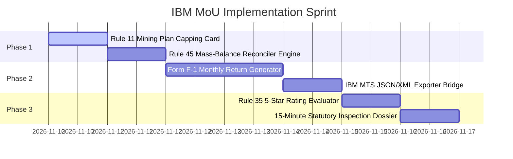

# ComplianceOS — IBM MoU Final Implementation Plan
**Document Version:** 3.0 (Production Roadmap)  
**Target Authority:** Indian Bureau of Mines (IBM, Ministry of Mines, Govt. of India)  
**Governing Legislation:** Mines and Minerals (Development and Regulation) Act (MMDR) 1957, Mineral Conservation and Development Rules (MCDR) 2017, Mines Act 1952, Metalliferous Mines Regulations (MMR) 1961.

---

## 1. Executive Summary & Partnership Value Proposition

ComplianceOS is engineered as the **upstream operational pre-validation gateway** for India's major mineral mining operations (the *ClearTax / Tally* equivalent for mining statutory compliance).

### 1.1 The Core Problem for the Indian Bureau of Mines (IBM)
1. **The "10th of the Month" Filing Nightmare:** Over 3,500 active major mineral leaseholders manually input complex mathematical data into the IBM Mining Tenement System (`ibmts.gov.in`). Data entry errors, mass-balance failures, and portal timeouts produce thousands of administrative show-cause notices under MCDR Rule 45(7).
2. **Inspection Bandwidth Limitations:** IBM has ~150–200 field inspection officers nationwide. Mines are physically inspected once every 6–12 months, creating long audit lags for boundary enforcement and production cappings.
3. **Revenue Leakage:** Illegal extraction beyond Mining Plan limits, transit pass recycling, and grade undervaluation cause significant royalty, DMF, and auction premium losses to state exchequers.

### 1.2 The ComplianceOS Solution Architecture
```
┌─────────────────────────────────────────────────────────────────┐
│                    MINE SITE OPERATIONS                         │
│  Daily Pit Shifts • DGPS Coordinates • Weighbridge Load Cells   │
└────────────────────────────────┬────────────────────────────────┘
                                 │ Real-time ingestion
                                 ▼
┌─────────────────────────────────────────────────────────────────┐
│              COMPLIANCEOS PRE-VALIDATION GATEWAY                │
│  • MCDR Rule 11 Mining Plan Excavation Capping Guard            │
│  • MCDR Rule 45 Mass-Balance Reconciler (Stock Balance Lock)    │
│  • DGMS 8-Register Safety Decay & Audit Readiness Tracker       │
│  • Automated Form F-1 Monthly Return Generator                  │
│  • MCDR Rule 35 5-Star Sustainable Mining Evaluator             │
│  • Official Mineral Tax Invoice & Dispatch Challan Suite        │
└────────────────────────────────┬────────────────────────────────┘
                                 │ Validated Schema (JSON / XML / PDF)
                                 ▼
┌─────────────────────────────────────────────────────────────────┐
│            NATIONAL GOVERNMENT INFRASTRUCTURE                   │
│   IBM MTS Portal (ibmts.gov.in) • State DMG Portals (e-Permit)  │
└─────────────────────────────────────────────────────────────────┘
```

---

## 2. Status Matrix: What is Built vs. Remaining

| Module | Feature Description | Statutory Reference | Status |
| :--- | :--- | :--- | :---: |
| **Frontend Foundation** | React 18+ Clean Modern Architecture (1:1 Vanilla Parity) | — | **Completed** |
| **Authentication** | Full Auth Lifecycle (Login, Signup, Verify, Password Reset) | IT Act 2000 | **Completed** |
| **Statutory Rates** | MMDR Schedule II Royalty, DMF (10%/30%), NMET (2%) | MMDR Sec. 9 | **Completed** |
| **Safety Engine** | DGMS 8-Register Readiness & Score Engine | MMR 1961 | **Completed** |
| **Shift Logging** | Daily Pit-wise ROM Extraction Ledger | MCDR Rule 45 | **Completed** |
| **Dispatches & Sales** | Buyer Ledger, Grade-wise Dispatches, Freight Deductions | Rule 45 Part III | **Completed** |
| **Tax Invoicing** | A4 Vector PDF Mineral Tax Invoice & Dispatch Challan | Rule 45 / CGST | **Completed** |
| **Capping Sentinel** | **MCDR Rule 11 Mining Plan Annual Excavation Capping Card** | Rule 11(1), (2) | **Completed (Sprint 1)** |
| **Stock Integrity** | **MCDR Rule 45 Mass-Balance Reconciler & Lock** | Rule 45(5) | **Completed (Sprint 2)** |
| **MTS Interchange** | **Form F-1 Monthly Return Generator & IBM MTS Exporter** | Rule 45 Form F-1 | **Completed (Sprint 3)** |
| **SDF Rating** | **MCDR Rule 35 5-Star Rating Self-Assessment** | Rule 35 | **Completed (Sprint 4)** |
| **Inspection Dossier**| **15-Minute Statutory Inspection Dossier (PDF)** | Rules 11, 45, 55 | **Completed (Sprint 5)** |

---

## 3. Detailed Specifications for Remaining Features

### Priority 1: MCDR Rule 11 Mining Plan Annual Excavation Capping Card
* **Legal Citation:** Mineral Conservation and Development Rules, 2017 — Rule 11(1) & 11(2).
* **Objective:** Ensure the mine operator never exceeds the approved annual Environmental Clearance (EC) and IBM Mining Plan production threshold, which otherwise triggers automatic statutory lease suspension.
* **Mathematical Model:**
  $$\text{Capacity Utilization (\%)} = \left(\frac{\text{Cumulative Year-to-Date ROM Extracted (MT)}}{\text{Approved Annual Mining Plan Target (MT)}}\right) \times 100$$
  $$\text{Remaining Allowance (MT)} = \max\left(0, \text{Approved Annual Target} - \text{Cumulative Extracted}\right)$$
* **Statutory Warning Thresholds:**
  * **Normal (Green, $< 85\%$):** Normal operation.
  * **Caution (Amber, $85\% - 95\%$):** Approaching annual cap. Triggers prompt to slow excavation or file a Review of Mining Plan (RMP).
  * **Critical Alert (Red, $> 95\%$):** Less than 5% quota remaining. Dispatches restricted to prevent Rule 11(2) suspension notice.
* **UI Location:** Top of Dashboard View & Production Log View.

---

### Priority 2: MCDR Rule 45 Mass-Balance Reconciler & Stock Lock
* **Legal Citation:** Mineral Conservation and Development Rules, 2017 — Rule 45(5).
* **Objective:** Eliminate clerical stock discrepancies and prevent unrecorded mineral removals before monthly return submission.
* **Mathematical Formula:**
  $$\text{Closing Stock (Pit-Head)} \equiv \text{Opening Stock} + \text{ROM Production} - \text{Dispatches} - \text{Waste/Rejects}$$
* **Validation Logic:**
  * If $\text{Dispatches} > (\text{Opening Stock} + \text{ROM Production})$, the system immediately locks the entry and triggers an alert:  
    `⚠ Illegal Transit Anomaly: Outbound dispatches exceed total available pit stock.`
* **UI Component:**
  * Header Badge: `✓ Rule 45 Mass-Balance: 100% Reconciled` (Green pill with animated status beacon).
  * Grade-wise Breakdown: Lumps vs. Fines vs. Concentrates stock ledger.

---

### Priority 3: Form F-1 Monthly Return Generator & IBM MTS Exporter
* **Legal Citation:** Mineral Conservation and Development Rules, 2017 — Rule 45 Form F-1 (Metallic Minerals) & Form F-2 (Non-Metallic).
* **Objective:** Generate the official statutory monthly return and provide a 1-click data bridge to `ibmts.gov.in`.
* **Feature Scope:**
  1. **Form F-1 Interactive Modal:**
     * **Part I (General Information):** Lease Code, IBM Registration Number, Mine Code, Lessee details, Lease area in hectares, State, District.
     * **Part II (Pit Operations & Employment):** Total days worked, number of shifts, average daily employment (men/women), explosives consumed, total ROM excavated.
     * **Part III (Dispatches, Ex-Mine Price & Royalty):** Grade-wise quantity dispatched, gross sale value, allowable beyond mine-head deductions, Ex-Mine Price (EMP), and royalty computed against IBM Average Sale Price (ASP).
  2. **1-Click "Export to IBM MTS (JSON / XML)":**
     * Formats data into the exact schema required for batch ingestion into the IBM Mining Tenement System portal.
  3. **Official Gazette Form F-1 PDF:**
     * Clean, printable, timestamped Gazette-style PDF ready for physical submission or archiving.

---

### Priority 4: MCDR Rule 35 Sustainable Mining 5-Star Rating Evaluator
* **Legal Citation:** Mineral Conservation and Development Rules, 2017 — Rule 35 (Star Rating of Mines).
* **Objective:** Evaluate and predict the mine's official IBM Star Rating (1 to 5 Stars) based on the Sustainable Development Framework (SDF).
* **Scoring Modules:**
  1. **Module 1: Scientific & Systematic Mining (0–30 pts)** — Compliance with approved mining plan, bench height/width geometry, stripping ratio.
  2. **Module 2: Environmental Protection & Green Belt (0–25 pts)** — Afforestation tree count, topsoil preservation, water sprinkling, dust suppression.
  3. **Module 3: Health, Safety & DGMS Compliance (0–20 pts)** — Vocational training, PME medical checkups, accident-free days, PPE compliance.
  4. **Module 4: CSR, DMF & Community Welfare (0–15 pts)** — Local drinking water, skill development, healthcare initiatives.
  5. **Module 5: Digital Monitoring & Boundary Protection (0–10 pts)** — DGPS pillar maintenance, digital weighbridge integration, online return filing.
* **Output:**
  * Star Rating Badge (**5-Star: $\ge 85\%$**, **4-Star: $75\% - 84\%$**, **3-Star: $60\% - 74\%$**).
  * Actionable GAP report showing exactly what points are needed to qualify for a 5-Star award.

---

### Priority 5: 15-Minute Statutory Inspection Dossier Generator
* **Objective:** Empower the mine manager to generate a complete, tamper-evident regulatory dossier for visiting IBM Inspecting Officers (RCM/COM) and DGMS Directors.
* **Compiled PDF Dossier Sections:**
  1. Mine identification, validity of lease, and DGPS boundary coordinates.
  2. Rule 11 Mining Plan utilization graph vs. annual ceiling.
  3. Rule 45 grade-wise stock balance ledger and weighbridge reconciliation.
  4. DGMS 8-Register compliance log and safety certification.
  5. Royalty, DMF, NMET payment reconciliation summary.
  6. Digital verification hash and Mines Manager sign-off block.

---

## 4. Accelerated Execution Timeline



| Step | Milestone | Deliverable | Target Component |
| :---: | :--- | :--- | :--- |
| **1** | **Rule 11 Excavation Capping Card** | Visual quota utilization bar + proactive breach alerts | `DashboardView.jsx` & `ProductionView.jsx` |
| **2** | **Rule 45 Mass-Balance Engine** | Automated stock equation verification + audit badge | `ProductionView.jsx` & `SalesView.jsx` |
| **3** | **Form F-1 & MTS Exporter** | Gazette Form F-1 generation + IBM MTS JSON/XML download | `FormsView.jsx` & New `FormF1Modal.jsx` |
| **4** | **Rule 35 5-Star Rating Evaluator** | Sustainable Development Framework interactive scorecard | New `StarRatingView.jsx` |
| **5** | **Statutory Inspection Dossier** | One-click comprehensive inspection audit PDF | Global Header Action Suite |

---

## 5. Government Pitch Strategy (Securing the MoU)

When presenting ComplianceOS to the **Controller General of Mines** or **Regional Controller of Mines (RCM)**:

1. **Framework:** Pitch under the **Government Digital India / Ease of Doing Business** public-private partnership model (analogous to GST Suvidha Providers (GSP) with GSTN or e-Return Intermediaries (ERI) with the Income Tax Department).
2. **Key Selling Points for IBM:**
   * **Zero Financial Cost to IBM:** SaaS deployed by leaseholders directly.
   * **100% Arithmetic Integrity:** Pre-validated Form F-1 returns eliminate clerical errors, saving thousands of officer hours.
   * **Real-time Illegal Mining Sentinel:** Automates detection of production beyond Mining Plan limits and transit anomalies before annual inspections.

